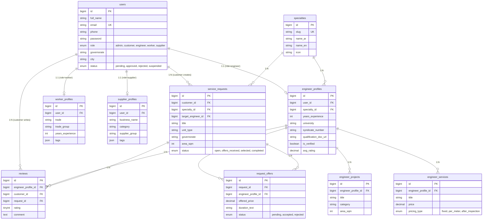

# 🗄️ تصميم قاعدة البيانات (MySQL Database & ERD) — مشروع BUNYORA

تم تصميم قاعدة بيانات **`bunyora_db`** بنظام **InnoDB** وترميز **`utf8mb4_unicode_ci`** (لدعم اللغة العربية بالكامل) وتقسيمها إلى **11 جدولاً مترابطاً (Normalized 3NF)** لتغطية جميع أدوار المستخدمين والعمليات داخل المنصة.

---

## 1. مخطط العلاقات بين الجداول (ERD - Entity Relationship Diagram)

---

## 2. شرح الجداول الـ 11 ووظيفة كل جدول

| # | اسم الجدول | الوظيفة في المشروع | العلاقات الأساسية (Foreign Keys) |
|---|---|---|---|
| 1 | `users` | الجدول الموحد لتسجيل الدخول لجميع الأدوار (`admin`, `customer`, `engineer`, `worker`, `supplier`). | الجدول الأب لملفات مقدمي الخدمات والطلبات. |
| 2 | `specialties` | التخصصات الهندسية الـ 10 (معماري، إنشائي، مدني، كهرباء، ديكور...). | يرتبط بـ `engineer_profiles` و `service_requests`. |
| 3 | `engineer_profiles` | الملف المهني للمهندس (الجامعة، رقم النقابة، ملف إثبات المؤهل، الخبرة، التقييم). | `user_id` -> `users.id`، `specialty_id` -> `specialties.id`. |
| 4 | `engineer_services` | الخدمات التي يقدمها المهندس وأسعارها الاسترشادية. | `engineer_profile_id` -> `engineer_profiles.id`. |
| 5 | `engineer_projects` | سابقة الأعمال والمشاريع المنفذة لكل مهندس (Portfolio). | `engineer_profile_id` -> `engineer_profiles.id`. |
| 6 | `worker_profiles` | بيانات العمال والصنايعية (المهنة، التصنيف، سنوات الخبرة، المهارات). | `user_id` -> `users.id`. |
| 7 | `supplier_profiles` | بيانات المحلات والمعارض والموردين (اسم المعرض، نوع الخامات، التوصيل). | `user_id` -> `users.id`. |
| 8 | `service_requests` | طلبات الخدمات الهندسية المرسلة من الفورم متعدد الخطوات. | `customer_id` -> `users.id`، `specialty_id` -> `specialties.id`. |
| 9 | `request_offers` | عروض الأسعار الفنية والمالية المقدمة من المهندسين للعميل. | `request_id` -> `service_requests.id`، `engineer_profile_id` -> `engineer_profiles.id`. |
| 10 | `reviews` | تقييمات وتعليقات العملاء على المهندسين بعد إتمام الخدمات. | `engineer_profile_id`، `customer_id`، `request_id`. |
| 11 | `newsletter_subscribers` | إيميلات المشتركين في نشرة أسعار الخامات الشهرية الموجودة في الفوتر. | مستقل. |

---

## 3. طريقة تشغيل واستيراد قاعدة البيانات في XAMPP (phpMyAdmin)

1. افتح **XAMPP Control Panel** واضغط **Start** أمام **Apache** و **MySQL**.
2. افتح المتصفح وادخل على `http://localhost/phpmyadmin`.
3. اضغط على تبويب **Import (استيراد)** من الأعلى.
4. اختر الملف: `database/bunyora_schema.sql` ثم اضغط **Go (تنفيذ)**.
5. سيتم تلقائياً إنشاء قاعدة البيانات **`bunyora_db`** بكل الجداول الـ 11 والعلاقات والبيانات الأولية!
